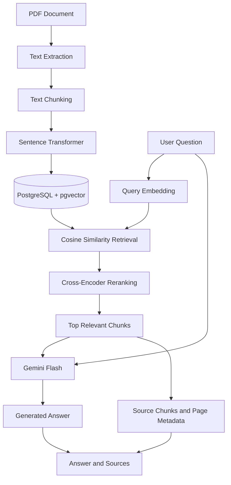
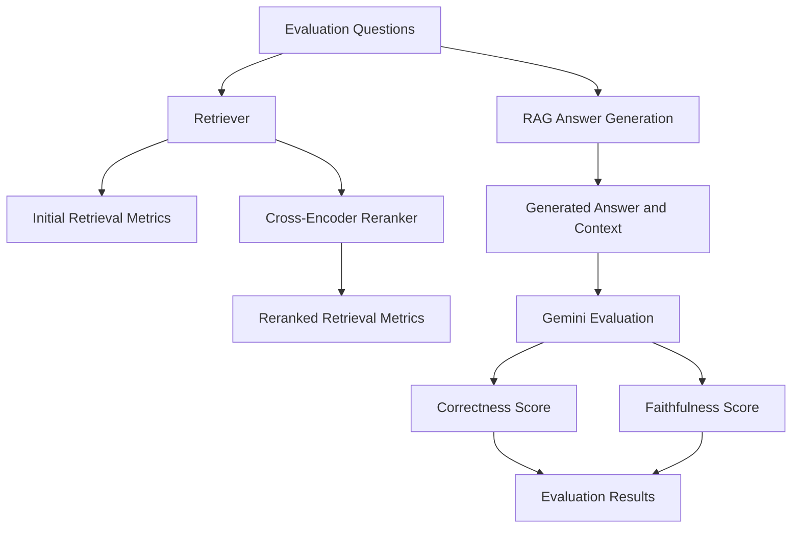

# Enterprise AI Assistant — Document-Based RAG

An AI-powered document question-answering system that allows users to ask questions about PDF documents and receive context-grounded answers using Retrieval-Augmented Generation (RAG).

The project combines semantic search, vector retrieval, cross-encoder reranking, and large language models to retrieve relevant document passages and generate answers based on supporting evidence. It also includes evaluation components for measuring retrieval quality, reranking effectiveness, answer correctness, and faithfulness to document context.

> **Project status:** Core RAG pipeline implemented and tested. Retrieval and reranking evaluation are implemented. Answer-quality evaluation has been tested on an individual question; full benchmark evaluation remains in progress.

## Table of Contents

- [Overview](#overview)
- [Features](#features)
- [Architecture](#architecture)
- [How It Works](#how-it-works)
- [Technology Stack](#technology-stack)
- [Project Structure](#project-structure)
- [Getting Started](#getting-started)
- [Environment Variables](#environment-variables)
- [Evaluation Framework](#evaluation-framework)
- [Example](#example)
- [Current Limitations](#current-limitations)
- [Roadmap](#roadmap)
- [Learning Outcomes](#learning-outcomes)

## Overview

General-purpose language models can produce incorrect or unsupported answers when asked about private documents or information outside their training data.

Enterprise AI Assistant addresses this problem by retrieving relevant passages from a document before generating an answer.

Instead of relying only on the language model's existing knowledge, the system uses document-specific context to ground its responses and preserve source information.

The repository includes the application code, a self-written demo PDF, and a committed retrieval dataset with evidence snippets.

### Key objectives

- Build a complete PDF-to-answer RAG pipeline.
- Store document embeddings in PostgreSQL using pgvector.
- Improve retrieval relevance with cross-encoder reranking.
- Ground generated answers in retrieved document passages.
- Evaluate retrieval performance with Recall@K and Mean Reciprocal Rank (MRR).
- Evaluate generated answers for correctness and faithfulness.

## Features

### Document processing

- PDF text extraction.
- Text chunking for retrieval.
- Semantic embedding generation.
- Storage of document chunks and their metadata.
- Page-number tracking for source identification.

### Semantic retrieval

- Sentence Transformer embeddings with 384 dimensions.
- PostgreSQL and pgvector for vector storage.
- Cosine-distance-based similarity search.
- Configurable retrieval depth and distance threshold.

### Cross-encoder reranking

The system retrieves an initial set of candidate chunks and reranks them using a cross-encoder.

The reranker uses `cross-encoder/ms-marco-MiniLM-L-6-v2` to score query–passage pairs and prioritize the most relevant evidence.

This two-stage retrieval process helps place relevant passages higher in the final context.

### Context-grounded answer generation

- Gemini Flash model integration.
- Document context supplied to the language model.
- Instructions to avoid unsupported claims.
- Responses designed to answer the user's specific question.
- Retrieved source passages and page metadata available from the RAG pipeline.

### Evaluation framework

- Retrieval Recall@K.
- Mean Reciprocal Rank (MRR) before and after reranking.
- Reranked retrieval hit rate.
- Ground-truth-based answer correctness scoring.
- Context-based faithfulness scoring.
- Structured evaluation output using Pydantic.
- Database model for storing generated answers and evaluation results.

## Architecture

The following diagram illustrates the implemented core pipeline.



### Evaluation architecture



The evaluation framework separates retrieval performance from answer quality. This makes it possible to investigate whether a weak answer comes from retrieving the wrong evidence, ranking useful passages poorly, or generating an answer that does not faithfully reflect the evidence.

## How It Works

### 1. PDF ingestion

A PDF document is processed to extract its text. The extracted text is divided into smaller chunks that can be embedded and retrieved independently.

### 2. Embedding generation

Each chunk is transformed into a numerical vector using a Sentence Transformer model. The current embedding dimension is 384.

### 3. Vector storage

Document chunks, page metadata, and embeddings are stored in PostgreSQL. The pgvector extension enables vector similarity operations directly in the database.

### 4. Candidate retrieval

A user's question is embedded into the same vector space. The retriever searches for relevant chunks using cosine distance, with configurable retrieval depth and a distance threshold.

### 5. Reranking

The cross-encoder evaluates each candidate passage alongside the query. The candidates are sorted by reranker score, and the highest-ranked passages are selected for the next stage.

### 6. Answer generation

The selected passages are combined into a context and passed to Gemini alongside the original question. The prompt instructs the model to use the supplied evidence, answer the specific question, and avoid unsupported information.

### 7. Evaluation

A ground-truth evaluation dataset is used to assess retrieval and reranking. An additional answer evaluator uses structured output to score correctness against a reference answer and faithfulness against the retrieved document context.

## Technology Stack

| Component | Technology |
|---|---|
| Backend | Python, Django |
| Database | PostgreSQL |
| Vector search | pgvector |
| Embedding generation | Sentence Transformers |
| Reranking | CrossEncoder |
| Language model | Google Gemini API |
| Structured evaluation | Pydantic |
| Evaluation data | Django ORM and PostgreSQL |
| Development environment | Python virtual environment |

## Project Structure

The following is a representative structure of the backend. Some filenames may differ depending on the final organization of your codebase.

```text
enterprise-ai-assistant/
└── backend/
    ├── config/
    │   └── settings.py
    ├── documents/
    │   ├── models.py
    │   ├── services/
    │   │   ├── embeddings.py
    │   │   ├── retriever.py
    │   │   ├── reranker.py
    │   │   ├── rag.py
    │   │   ├── llm.py
    │   │   └── evaluator.py
    │   ├── migrations/
    │   ├── tests.py
    │   └── urls.py
    ├── manage.py
    ├── requirements.txt
    └── .env
```

**Main services**

- `embeddings.py` — generates embeddings for queries or document chunks.
- `retriever.py` — performs vector similarity retrieval.
- `reranker.py` — reranks retrieved passages using a cross-encoder.
- `rag.py` — orchestrates retrieval, reranking, context construction, and answer generation.
- `llm.py` — integrates the Gemini API.
- `evaluator.py` — evaluates retrieval, reranking, and generated answers.
- `models.py` — defines document chunks, evaluation questions, and saved answer evaluation results.

## Getting Started

### Prerequisites

Install or configure:

- Python 3.12 or a compatible version.
- PostgreSQL.
- The PostgreSQL pgvector extension.
- A Google Gemini API key.
- Git.

### 1. Clone the repository

```bash
git clone <YOUR_GITHUB_REPOSITORY_URL>
cd enterprise-ai-assistant/enterprise-ai-assistant/backend
```

Replace the placeholder with your actual repository URL. Adjust the directory path if your repository has a different layout.

### 2. Create a virtual environment

On Windows:

```bash
python -m venv venv
venv\Scripts\activate
```

On macOS or Linux:

```bash
python3 -m venv venv
source venv/bin/activate
```

### 3. Install dependencies

```bash
pip install -r requirements.txt
```

Ensure the requirements file includes the packages used by your actual implementation, including Django, the PostgreSQL adapter, pgvector, Sentence Transformers, Pydantic, and the Google GenAI SDK.

### 4. Configure environment variables

Create a `.env` file in the backend directory:

```env
DJANGO_SECRET_KEY=replace_with_a_secure_django_secret
DJANGO_DEBUG=true
DJANGO_ALLOWED_HOSTS=localhost,127.0.0.1,backend

POSTGRES_DB=ai_assistant
POSTGRES_USER=postgres
POSTGRES_PASSWORD=your_database_password
POSTGRES_HOST=localhost
POSTGRES_PORT=5432

GEMINI_API_KEY=your_gemini_api_key
GEMINI_MODEL=gemini-3.8-flash
```

Never commit real credentials to GitHub.

### 5. Configure PostgreSQL and pgvector

Create the PostgreSQL database:

```sql
CREATE DATABASE ai_assistant;
```

Connect to the database and enable pgvector:

```sql
CREATE EXTENSION IF NOT EXISTS vector;
```

The PostgreSQL user configured in Django must have the required permissions.

### 6. Apply migrations

```bash
python manage.py migrate
```

### 7. Create an administrator account

```bash
python manage.py createsuperuser
```

Use this account to sign in. Create additional accounts through Django admin at `/admin/`; public registration is disabled.

The API uses session authentication and CSRF protection. Document list, detail, edit, delete, retrieval, multi-document, and agent operations only accept the signed-in user's documents. Uploads take their owner from the session. Uploaded files can only be downloaded through the authenticated document download endpoint.

With `DJANGO_DEBUG=false`, Django marks session and CSRF cookies `Secure`; serve the app over HTTPS in production. For local development over HTTP, enable `DJANGO_DEBUG=true` in the backend environment.

Existing documents retain their current owner assignment. Review and reassign legacy documents in Django admin if they belong to a different user.

### 8. Run the development server

```bash
python manage.py runserver
```

The Django development server normally runs at:

`http://127.0.0.1:8000/`

Actual API routes depend on the project's configured URL patterns.

## Environment Variables

| Variable | Purpose |
|---|---|
| `SECRET_KEY` | Django cryptographic secret |
| `DEBUG` | Enables or disables Django debug mode |
| `DB_NAME` | PostgreSQL database name |
| `DB_USER` | PostgreSQL username |
| `DB_PASSWORD` | PostgreSQL password |
| `DB_HOST` | PostgreSQL host |
| `DB_PORT` | PostgreSQL port |
| `GEMINI_API_KEY` | API credential for Gemini |
| `GEMINI_MODEL` | Configured Gemini model identifier, if supported by your settings |

Use environment variables or a secrets manager for sensitive configuration. For production, disable debug mode and configure secure settings, allowed hosts, and database access appropriately.

## Evaluation Framework

A key part of this project is measuring system quality instead of relying only on a few successful answers.

### Retrieval evaluation

The committed retrieval dataset includes questions, reference answers, and short evidence snippets from the self-written demo document. The database model retains its legacy chunk ID field for compatibility, but the retrieval benchmark no longer uses chunk IDs as labels.

The retriever is evaluated at different values of K.

**Recall@K**

Measures the proportion of evaluation questions for which at least one known relevant chunk appears in the top K retrieved results, when using the current hit-based implementation.

**Mean Reciprocal Rank (MRR)**

Measures how highly the first relevant chunk appears in the retrieved results.

\[
MRR = \frac{1}{N}\sum_{i=1}^{N}\frac{1}{rank_i}
\]

Here, \(rank_i\) is the rank of the first relevant result for question \(i\). A question with no relevant result contributes zero.

### Reranking evaluation

The committed dataset labels relevant chunks with short evidence snippets rather than database chunk IDs. Run it against the included self-written demo PDF after uploading that PDF and substituting the returned document ID:

```powershell
cd backend
python manage.py evaluate_retrieval --document-id <document-id> --k 5 --retrieval-pool 20
```

The baseline and reranked MRR use the same `k`; `retrieval-pool` controls the number of candidates available to the reranker.

The previously reported values were `0.1874` before reranking and `0.6731` after reranking, a ratio of approximately `3.59×`. That comparison used a baseline pool of 20 chunks and a reranked pool of 5, so it used different cutoffs. The original local questions were unavailable in the committed database, so those values are preliminary and cannot be reproduced from the original question set.

### Answer-quality evaluation

The answer evaluator uses a Pydantic schema to obtain structured results:

```python
class AnswerEvaluation(BaseModel):
    correctness: float
    faithfulness: float
    explanation: str
```

- **Correctness:** How well the generated answer addresses the question compared with the ground-truth answer.
- **Faithfulness:** Whether the generated answer is supported by the retrieved document context.
- **Explanation:** A short rationale for the scores.

A single-question test returned a correctness score of `1.0` and a faithfulness score of `1.0`. This verifies that the evaluation call and structured parsing work; it does not establish overall system accuracy.

The project also includes a database model intended to save generated answers, their retrieved context, and their evaluation scores so that evaluation can be run separately from answer generation.

**Full answer-level benchmark results have not yet been established.** Gemini API quota limitations interrupted the multi-question evaluation during development.

## Example

Consider the question:

**Question:** What did Alicia do to Gabriel?

**Reference answer:**

> Alicia shot Gabriel point-blank in the face.

**Example generated answer:**

> Based on the document, Alicia picked up a gun and shot Gabriel point-blank in the face, murdering him.

The answer evaluator returned:

| Metric | Score |
|---|---:|
| Correctness | 1.0 |
| Faithfulness | 1.0 |

These scores belong to an individual test. They should not be interpreted as the average performance of the entire RAG system.

## Current Limitations

- The full answer-quality benchmark is not yet complete.
- Gemini API free-tier quotas can interrupt batch evaluations.
- The evaluation dataset is relatively small and needs broader coverage.
- Repeated generation can produce different wording and scores.
- Retrieval thresholds require further calibration.
- The project needs additional tests for unsupported questions, ambiguous questions, incomplete context, and conflicting passages.
- Production deployment and operational monitoring still require setup for the target environment.

## Roadmap

### Evaluation and reliability

- [x] Build a PDF-to-RAG processing pipeline.
- [x] Store embeddings in PostgreSQL with pgvector.
- [x] Implement cosine-distance retrieval.
- [x] Implement cross-encoder reranking.
- [x] Implement retrieval and reranking evaluation.
- [x] Test structured answer-quality evaluation on an individual question.
- [x] Create a database model for storing answer evaluation results.
- [ ] Complete and verify the saved-answer evaluation workflow.
- [ ] Run a broader answer-quality benchmark.
- [ ] Add automated regression tests.
- [ ] Calibrate retrieval thresholds against a larger dataset.

### Product improvements

- [ ] Return user-friendly citations with page numbers.
- [ ] Support multiple uploaded documents.
- [ ] Improve handling of unanswerable questions.
- [ ] Add conversation history where appropriate.
- [ ] Build an evaluation metrics API or dashboard.
- [ ] Add deployment, logging, and production monitoring.

## Learning Outcomes

This project has provided practical experience with:

- Designing a retrieval-augmented generation pipeline.
- Working with vector embeddings and PostgreSQL vector search.
- Understanding the difference between retrieval and reranking.
- Integrating an LLM into a Django backend.
- Structuring model output with Pydantic.
- Building a ground-truth evaluation dataset.
- Measuring retrieval effectiveness with Recall@K and MRR.
- Evaluating generated answers for correctness and faithfulness.
- Designing database-backed evaluation workflows.
- Handling API quotas and separating generation from evaluation.

## Contributing

Contributions and suggestions are welcome. Potential areas include improving retrieval quality, expanding the evaluation dataset, adding source citations, and building automated regression tests.

1. Fork the repository.
2. Create a feature branch.
3. Implement and test your changes.
4. Submit a pull request describing the change.

## License

Choose a license before publishing the repository. If you have not selected one yet, this project currently has no explicitly stated open-source license.

---

**Enterprise AI Assistant** is a learning and engineering project focused on building and evaluating document-grounded AI systems. Its long-term goal is to make document question answering more reliable, transparent, and measurable.
